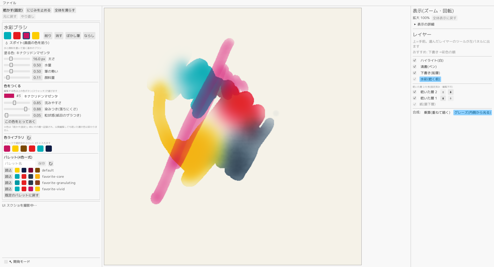

# かさねいろ(kasaneiro)

自分用のお絵描きツールです。水彩らしいにじみ・混色・透けのような表現をしやすくするための機能を実装しています。

<p align="center">
  
</p>

## コア要件(3つ)

1. **wet-on-wet** — 先に置いた色の近くに別の色で描くと、馴染んで綺麗なグラデーションになる(黄+青が濁らず緑に馴染むのが判定基準)
2. **グレージング** — 乾いた色の上に別の色を描くと、下の層が動かず、重なりが透けて見える(Kubelka-Munk の光学合成)
3. **削り** — リフト(再湿潤して顔料を浮かせる。ステイニングの強い顔料は紙に色が残る)+完全消去の2ツール構成

## 主な機能

- 水の流体シミュレーション(Curtis 1997 簡略版)+ mixbox による物理ベース混色
- 水彩ブラシ5種(塗る・削り・消す・ぼかし筆・吸い取り)。2色を1筆に含ませる分離色、置いたまま色水が流れ出る「筆の含み」
- 紙の凹凸(紙ハイト)でにじみの前線・粒状感に表情を付けられる(シミュ側の紙の質感は既定オフ。開発モードのスライダーで有効化)
- 下書き鉛筆 → 清書ペン → 彩色 → 白ハイライトのワークフロー(清書ペンの線は水の「土手」になり、はみ出しを防ぐ)
- ランタイム編集可能な4色パレット+色ライブラリ(顔料の色・沈みやすさ ρ・染みつき ω・粒状感 γ・粒の細かさ μ を編集して保存。定番の水彩絵具を含む24色を同梱)
- レイヤー: 乾かす(焼き込み)/ Fast Dry / 再湿潤、乾燥レイヤーの並べ替え、レイヤーごとのパレット記録
- 作品保存(`works/*.kasane`。湿った絵の具ごと保存して翌日続きが描ける)/ PNG 書き出し
- キャンバス 512/1024/2048 選択式、パン・ズーム・回転、アクティブタイルによる濡れ面積比例の計算コスト
- 筆圧対応ペン(Windows Ink)、Undo/Redo(線画は多段・水彩は1段)
- WGSL ホットリロード・プリセット保存・8モードのデバッグ表示・ストローク記録再生など、パラメータ調整の反復を速くする装備一式(H1〜H6)

## ビルドと実行

Rust は [mise](https://mise.jdx.dev/) で管理している(`mise.toml`)。

```sh
mise run run          # 起動
mise run test         # 全テスト(e2e は GPU 必須)
mise run test:quick   # GPU 不要のテストだけ(純関数クレート + シェーダー検証 + SimParams レイアウト)
mise run test:e2e     # e2e テストだけ(GPU 必須)
mise run bench        # 性能計測(GPU 必須)
mise run lint         # clippy
mise run release      # 配布用リリースビルド(アセット埋め込み)
```

`mise tasks` で一覧が出る。中身は `mise.toml` の `[tasks]` を参照。

workspace は `km`(Kubelka-Munk 純関数)・`pigment`(mixbox 混色)・`paint-core` の3クレート+ルートのバイナリクレートで構成。シェーダー(WGSL)は `assets/shaders/` から実行時ロードされ、保存すると即座にホットリロードされる。

## ドキュメント

| ドキュメント | 内容 |
|---|---|
| [docs/status.md](docs/status.md) | 現在の実装状況(正典) |
| [docs/changelog.md](docs/changelog.md) | 実装の経緯(時系列の変更ログ) |
| [docs/requirements.md](docs/requirements.md) | 要件仕様 |
| [docs/design.md](docs/design.md) | 設計原則・主要な設計判断とその理由・先送り判断 |
| [docs/architecture.md](docs/architecture.md) | 実装構造(モジュール・テクスチャ・パス順序・シェーダー) |
| [docs/parameters.md](docs/parameters.md) | 全パラメータと顔料個性 ρ/ω/γ/μ のリファレンス |
| [docs/note/00-overview.md](docs/note/00-overview.md) | 技術ノートの起点(再利用できる知見と最新の情報) |
| [docs/memo/](docs/memo/) | 日付つきの検討メモ(その時点の比較・試行錯誤の経緯) |

## ライセンスについて

混色に [mixbox](https://github.com/scrtwpns/mixbox)(CC BY-NC)を使用しているため、**非商用**。個人の道具として開発しており、配布・商用化は当面しない(商用化する場合は自作スペクトラル WGM へ差し替える計画 — docs/design.md §4)。
